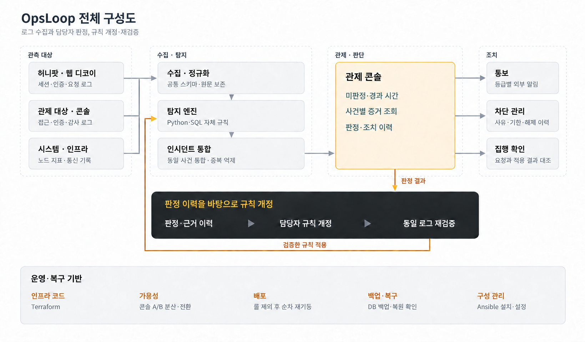
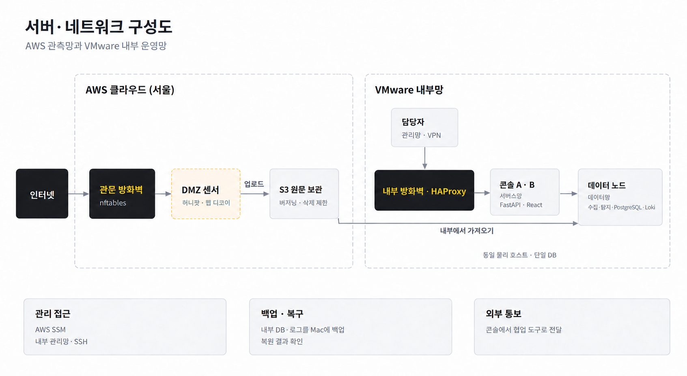
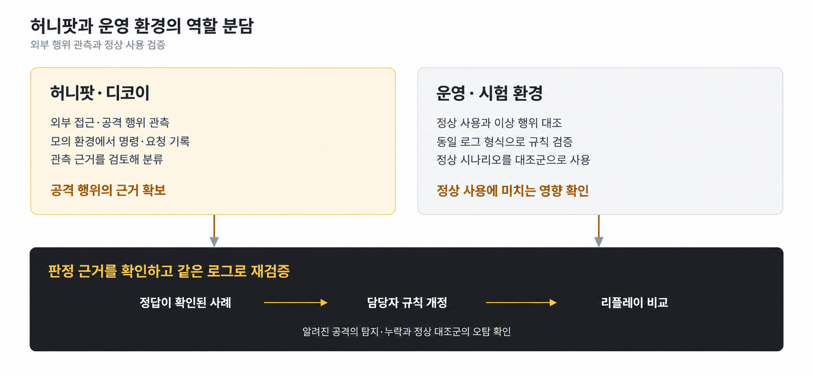

# OpsLoop 구성도 안내

2026-10-16 철거 전 구축·시험 구성을 설명하는 자료다. 현재 가동 상태나 10/17 코드 보완의 운영 배포를 나타내지 않는다.

## 상세 네트워크 도면

[OpsLoop_아키텍처_v10.drawio](OpsLoop_아키텍처_v10.drawio)는 주소·포트·망 구간·수집/차단 경로를 표시한 편집 가능한 도면이다. 이전 v6~v9는 변경 이력으로 보존한다. 아래 PNG 세 장은 발표용으로 별도 작성한 개념도이며, v10 파일을 그대로 내보낸 그림이 아니다.

상세 도면의 콘솔 B ‘대기·전환 시험’은 평소 꺼 둔 예비 콘솔을 시험 때 켠다는 뜻이다. 항상 두 콘솔이 동작한 것은 아니다. 도면은 네트워크와 수집 경로를 중심으로 하며 AI 추론 서버 등 모든 구성 요소를 담지는 않는다. 최종 기능과 시험 조건은 [README](../README.md) 및 연결된 증거를 따른다.

## 전체 처리 흐름

- 통보는 사건 생성 등 설정된 조건에 따라 나가며 사람의 판정 완료를 기다리는 단계가 아니다.
- 판정 저장과 차단 요청은 별개다. 사람이 승인한 범위의 차단을 자동 집행하며, ‘함께 차단’ 승인에는 후속 출발지 자동 등록도 포함될 수 있다.
- 담당자가 후보 규칙을 고치고 같은 로그로 비교한 뒤 적용한다. 판정 저장만으로 규칙이나 모델이 자동 학습되지 않는다.
- 그림 아래의 A/B 분산·전환은 예비 B를 켠 시험 조건이다. 평시 예비 B는 꺼져 있었으며 같은 Mac의 장애와 단일 DB 장애를 모두 견딘다는 뜻이 아니다.

## 서버·네트워크 개요

화살표는 주로 자료 흐름을 나타낸다. S3 원장은 내부 데이터 노드가 시작한 연결로 가져온다. 관리는 AWS SSM과 내부 관리망·VPN 경로를 사용한다. 허용한 S3·SSM·DNS 등의 통신과 외부 통신의 잔여 위험은 [네트워크 설계](2026-09-18-네트워크-설계.md) 및 [README 한계](../README.md#한계)를 따른다. 같은 물리 호스트·단일 DB라는 조건을 생략하지 않는다.

## 관측과 검증의 역할

허니팟은 공격으로 의심되는 행위의 근거를 모으고, 운영·시험 환경에서는 정한 정상 시나리오와 비교한다. 그림의 ‘정답이 확인된 사례’는 문서화한 판정 기준과 검토 기록에 따른 사례를 뜻한다. 모든 기록에 독립적인 정답이 있다는 뜻은 아니다. 한정된 표본의 재적용 결과를 실제 운영 정확도나 시간 절감으로 일반화하지 않는다.
